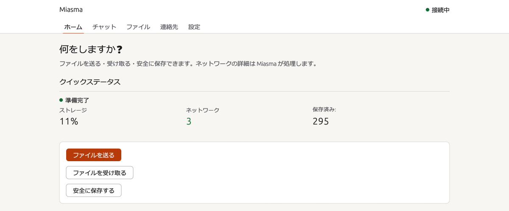
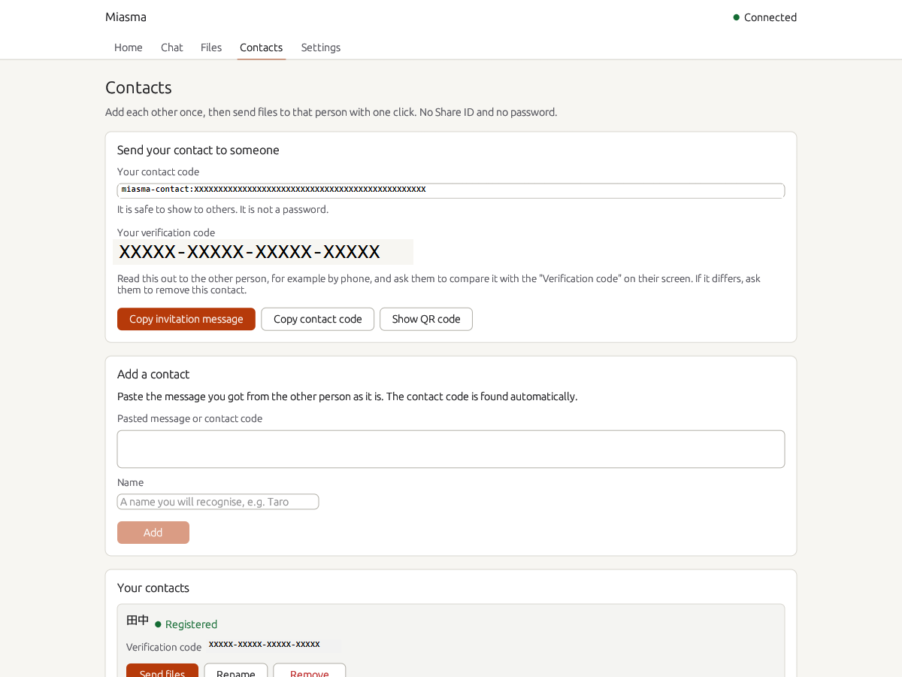
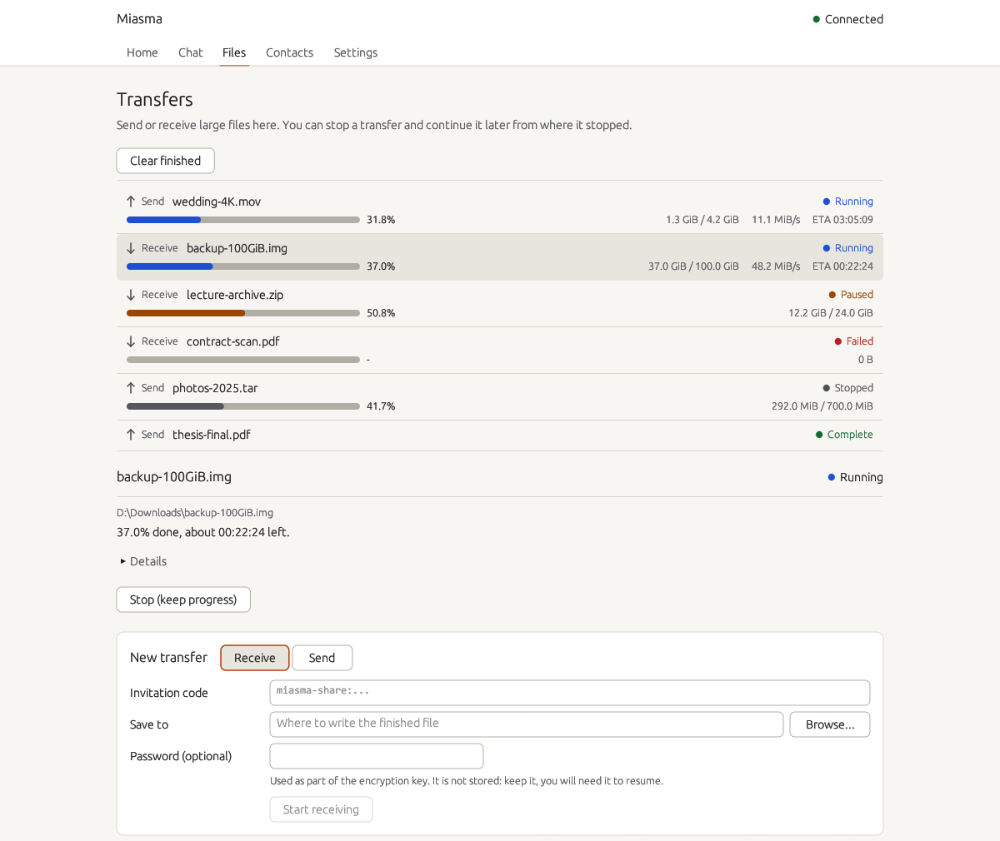
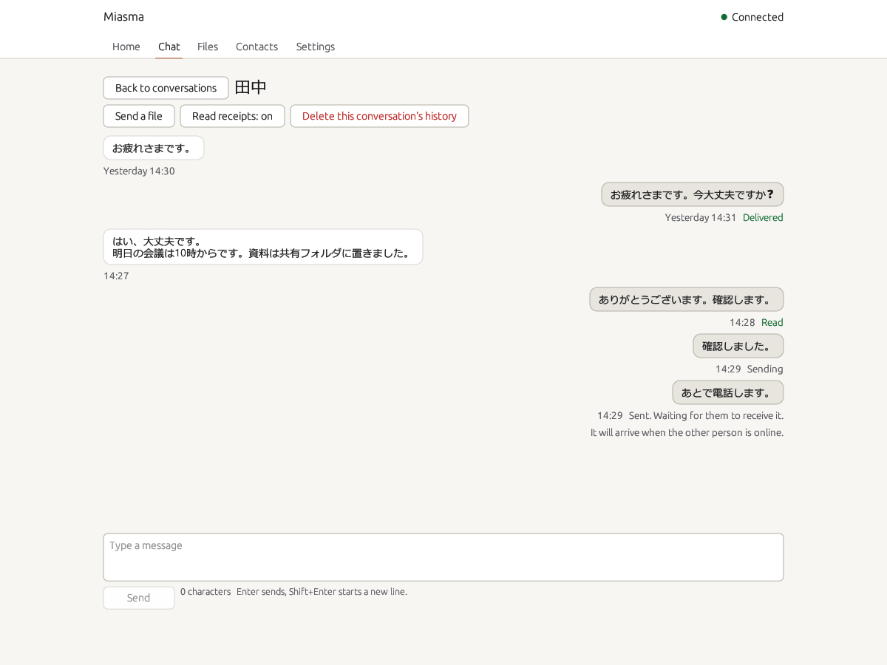
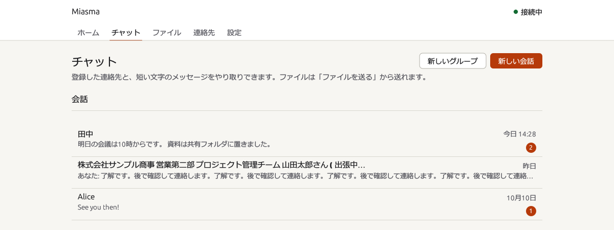
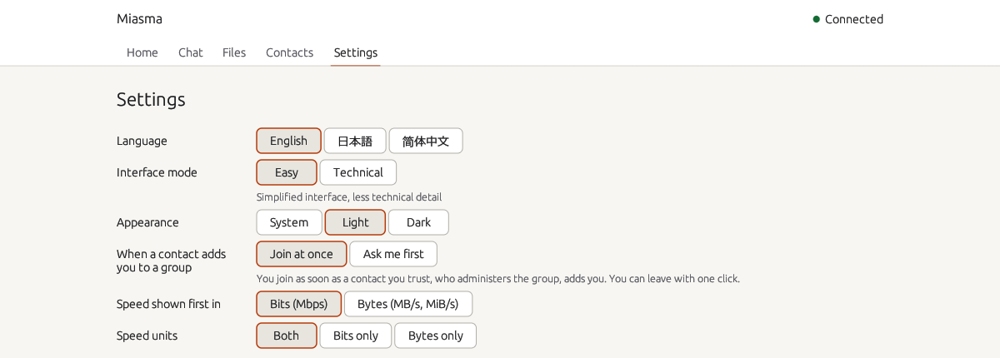

# Miasma

[English](README.md) | **日本語**

[](https://github.com/MasayukiTa/miasma-protocol/actions/workflows/ci.yml)
[](https://github.com/MasayukiTa/miasma-protocol/releases)
[](SECURITY.md)
[](LICENSE)

Miasma は、信頼できる相手へファイルを送り、自分のファイルを安全に保管するためのアプリです。ファイルを企業のサーバーに預けません。自分の Miasma が相手の Miasma へ直接つながり、すべてを暗号化して運びます。直接つながらないときは中継を使います。Windows と macOS で動き、Android とブラウザ版も開発中です。

> [!IMPORTANT]
> Miasma はベータ版で、外部の監査を受けていません。漏れると重大な被害が出る情報には使わないでください。詳しくは「[信頼性と安全性](#信頼性と安全性)」をご覧ください。



## できること

ピアツーピアの知識は要りません。毎日の操作に合わせて作ってあります。

- **信頼できる相手へファイルを送れます**。相手とファイルを選んで送るだけです。アカウントも、ウェブサイトへのアップロードも、リンクの貼り回しも要りません。
- **ファイルを受け取れます**。登録した相手からのファイルはアプリに届きます。共有 ID(任意でパスワード付き)でも受け取れます。
- **ファイルを安全に保管できます**。暗号化した状態で自分のパソコンに保存し、あとで取り出せます。
- **会話やグループでやり取りできます**。1 人の相手にもグループにも短いメッセージを送れます。相手がオフラインの間に送った分は保持し、戻ってきたときに届けます。
- **回線が不安定でも使えます**。大きな転送は止めても、止まったところから続けられます。
- **日本語で使えます**。画面は日本語、英語、簡体字中国語に対応しています。

デスクトップアプリは Windows と macOS で動きます。ほかに、ターミナル派のためのコマンドラインツール、ソースに含まれる Android アプリ、ブラウザ版があります。

## 画面

以下の画面はサンプルのデータです。

| | |
|---|---|
|  |  |
| ホーム。送る、受け取る、保存するを選びます。状態も 1 行で分かります。 | 連絡先(英語表示)。連絡先コードを 1 度交換すれば、あとは 1 クリックで送れます。コードは伏せてあります。 |
|  |  |
| ファイル(英語表示)。進み具合、速度、残り時間を表示します。大きな転送は止めて再開できます。 | チャット(英語表示)。メッセージごとに配達と既読の状態が分かります。 |
|  |  |
| 会話とグループの一覧。 | 設定(英語表示)。言語、外観、グループへの参加、速度の単位を選べます。 |

## はじめかた

Miasma は、送る側と受け取る側の両方に必要です。お使いのパソコンに合うものを、[Releases ページ](https://github.com/MasayukiTa/miasma-protocol/releases)からダウンロードしてください。各リリースに、含まれるファイルの一覧があります。お使いの環境向けのファイルが無いときは、「[ソースからビルドする](#ソースからビルドする)」をご覧ください。

### Windows

Rust や Visual Studio などの開発ツールは要りません。

1. [Releases ページ](https://github.com/MasayukiTa/miasma-protocol/releases)で、使いたいリリースから `Miasma-Setup-<バージョン>-x64.exe`(例: `Miasma-Setup-0.3.2-beta.12-x64.exe`)をダウンロードします。64 ビット Windows 用のインストーラーです。
2. 実行して、画面の案内に従います。Miasma デスクトップ、バックグラウンドサービス、コマンドラインツールが、まとめて `C:\Program Files\Miasma Protocol` に入ります。Microsoft Visual C++ ランタイムが無いパソコンでは、それも入ります。管理者の承認を一度求められます。
3. インストーラーにはまだコード署名が付いていないので、Windows SmartScreen の警告(「Windows によって PC が保護されました」)が出ることがあります。「詳細情報」を押し、「実行」を選んでください。ダウンロードしたファイルが公開したものと同じか確かめるには、同じリリースの `SHA256SUMS-windows.txt` と SHA-256 を見比べます。

   ```powershell
   Get-FileHash .\Miasma-Setup-0.3.2-beta.12-x64.exe -Algorithm SHA256
   ```

   表示されたハッシュが、同じファイル名の横に書かれたものと一致している必要があります。
4. スタートメニューから Miasma を起動します。初回は「Set Up Node」(ノードを設定)を押します。少し待つと、自分用の暗号鍵が作られます。

古い版の上から新しいインストーラーを実行すると、データを残したまま更新されます。削除は Windows の設定の「アプリ」から行います。データ(`%LOCALAPPDATA%\miasma` の下)は消えません。サイレントインストールは `Miasma-Setup-<バージョン>-x64.exe /quiet` です。詳しくは [installer/RELEASE_NOTES_WINDOWS.md](installer/RELEASE_NOTES_WINDOWS.md)(英語)を参照してください。よくある問題の対処は [docs/TROUBLESHOOTING.md](docs/TROUBLESHOOTING.md) にあります。

**開発者・上級者向け:** リリースに Windows 用のインストーラーが無いとき、または自分でビルドしたいときは、「ソースからビルドする」を参照してください。

### macOS

1. 最新のリリースから `Miasma-macOS.zip`(Apple シリコン用)をダウンロードし、展開します。
2. アプリは公証を受けていません。ターミナルで次のコマンドを 1 度だけ実行してから、`Miasma.app` を開きます。

   ```sh
   xattr -dr com.apple.quarantine Miasma.app
   ```

3. 初回は、アプリの案内に従ってノードを設定します。

### Android

Android アプリはソース(`android/`)にありますが、まだダウンロード配布はしていません。試すときは、下のとおりソースからビルドしてください。

### ウェブ

ブラウザ版は `web/` にあります。デスクトップアプリかコマンドラインツールを起動した状態で `miasma web --open` を実行すると、ブラウザで開きます。ノードが動いていないときは、その端末の中だけで動きます。

### 連絡先を追加してファイルを送る

1. 「連絡先」を開き、「Copy invitation message」(招待メッセージをコピー)を押します。コピーしたメッセージを、チャットやメールなど好きな方法で相手へ送ります。
2. 相手は「連絡先」を開き、受け取ったメッセージを「Add a contact」(連絡先を追加)へそのまま貼り付けます。呼び名を入れて「Add」(追加)を押します。続けて、相手の側でも同じ手順を逆向きに行い、お互いに 1 度ずつ追加します。
3. 両方の画面にある「確認コード」を見比べます。たとえば電話で読み上げて確かめます。違っていたら、その連絡先を削除してください。
4. 連絡先の横の「Send files」(ファイルを送る)か、ホームの「ファイルを送る」を押し、ファイルを選びます。
5. 受け取る側は「ファイル」に届いたファイルが見えます。大きなファイルは、「ファイル」で進み具合を見たり、止めて再開したりできます。

## ほかとの違い

- **ファイルを預かるサーバーがありません**。アカウントも中央の保管場所もありません。ファイルは自分のパソコンから相手のパソコンへ渡ります。
- **まず直接つなぎ、だめなら中継を使います**。Miasma は 2 台を直接つなごうとします。できないときは中継を使い、その理由を表示します。設定の「Check network」(ネットワークを確認)で、お使いのネットワークで何ができるかが分かります。
- **暗号化します**。ファイルの中身を暗号化します。共有 ID で渡すときは、パスワードも付けられます。
- **不安定な回線に強い作りです**。転送は再試行し、止めても、止まったところから再開できます。
- **保存したものを見て、消せます**。設定に、データの保存場所が出ます。完了した転送や会話の履歴を消すと、アプリの保存領域から削除します。
- **版が違っても通じます**。新旧の版が互いを受け流し、相手待ちのときは理由を表示します。過去の版の形式は、バイト単位の試験で固定しています。
- **既定で耐量子の鍵交換を使います**。個人の会話の鍵交換は、既定で耐量子 hybrid(X25519 + ML-KEM-768)が必須です。相手のアプリが対応していないときは、classical の方式に黙って切り替えて送ることはしません。互換性が足りないことを表示して送信を断りますので、相手に新しい版への更新をお願いしてください。詳しくは [docs/pqc-session-upgrade.md](docs/pqc-session-upgrade.md)(英語)をご覧ください。

プロトコルの中身(消失訂正符号を使った内容アドレス指定の保存、Kademlia DHT、中継とオニオンルーティングの選択肢)は、[設計判断の記録](docs/adr/)と [docs/variant-guide.md](docs/variant-guide.md) をご覧ください。

## 信頼性と安全性

Miasma はベータ版で、外部の監査を受けていません。漏れると重大な被害が出る情報には使わないでください。

分かっている制限は [SECURITY.md](SECURITY.md#known-security-limits-beta) にまとめています(英語)。頼る前に必ず読んでください。要点は次のとおりです。

- 共有 ID を持つ人や、あなたのノードを調べられる人は、接続に関する情報の一部を知り得ます。
- 既定の設定では、あなたのノードが、ほかのノードのために暗号化した断片を預かります。この動作は止められます。
- 自分のユーザーアカウントで動くプログラムなら、Miasma のバックグラウンドサービスを操作できます。

連絡先は必ず確認コードで確かめてください。この確認が、画面の向こうにいる人が思っていた相手かどうかを教えてくれます。

## ソースからビルドする

安定版の [Rust](https://rustup.rs) が要ります。

```sh
cargo build --release --package miasma-cli --package miasma-desktop
```

- macOS のアプリ: `bash scripts/build-macos.sh` を実行し、`open dist/Miasma.app` で開きます。そのときの Mac 向けにビルドし、公証なしでローカル署名します。
- Windows のパッケージ: `scripts/build-release.ps1`、`scripts/package-release.ps1`、`scripts/build-installer.ps1` を使います。
- Android: `./scripts/build-android.sh` を使います(`--setup` で道具を用意します)。API 36 が対象で、Android SDK と NDK が要ります。
- テスト: `cargo test --workspace`

## リポジトリの構成

```
crates/      Rust のワークスペース。中核のプロトコルと保存、CLI とデーモン、
             デスクトップアプリ、BitTorrent ブリッジ、モバイル用バインディング(FFI)、
             ブラウザ用 WASM
android/     Android アプリ(Kotlin、Gradle)
ios/         iOS アプリの土台(Swift)。受け取り中心で、完全なクライアントではありません
web/         ブラウザ版(PWA)
installer/   Windows インストーラーの定義(WiX、MSIX)
scripts/     ビルド、パッケージ、スモークテスト、長時間テストのスクリプト
docs/        設計判断の記録、トラブル対応、手順書、画面の画像
```

## 貢献する

課題の報告やプルリクエストを歓迎します。変更は小さくまとめ、安全性や対応環境についての記述は正直に保ってください。プルリクエストの前に `cargo fmt --all` と `cargo clippy --workspace --all-targets` を実行してください。CI がテスト一式を実行します。安全性の問題を報告するときは [SECURITY.md](SECURITY.md) をご覧ください。

## ライセンス

Miasma は [LICENSE](LICENSE) に記載のライセンスで公開しています。
