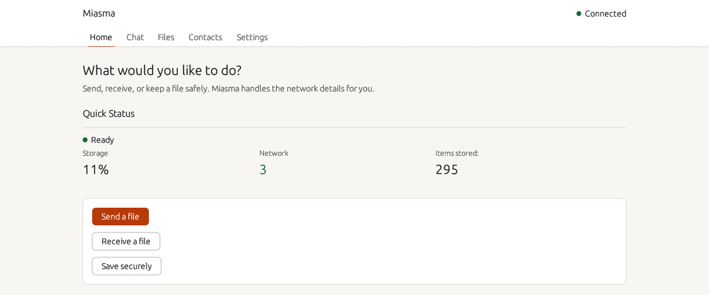

# Miasma

**English** | [日本語](README.ja.md)

[](https://github.com/MasayukiTa/miasma-protocol/actions/workflows/ci.yml)
[](https://github.com/MasayukiTa/miasma-protocol/releases)
[](SECURITY.md)
[](LICENSE)

Miasma lets you send a file to someone you trust, and keep your own files safe, without handing them to a company's server. Your Miasma app talks straight to your contact's Miasma app, encrypts everything on the way, and falls back to a relay when a direct connection is not possible. It runs on Windows and macOS, with Android and a browser client in progress.

> [!IMPORTANT]
> Miasma is **beta software and has not been externally audited**. Do not use it for material whose exposure would be serious. See [Trust and security](#trust-and-security).



## What it does

You do not need to know how peer-to-peer networks work. The app is built around a few everyday actions.

- **Send a file to a trusted contact.** Pick the person, pick the file, and send. No account, no upload to a website, and no link to paste around.
- **Receive a file.** Files from your contacts show up in the app. You can also receive by Share ID, with an optional password.
- **Keep a file safely.** Save a file in encrypted form on your own computer and get it back later.
- **Talk in conversations and groups.** Send short messages to one contact or to a group. Messages sent while someone is offline are held and delivered when they return.
- **Work on a poor connection.** Large transfers can be stopped and continued later from where they stopped.
- **Use it in your language.** The interface is available in English, Japanese and Simplified Chinese.

Miasma runs as a desktop app on Windows and macOS. There is also a command-line tool for people who prefer a terminal, an Android app in the source tree, and a browser client.

## Screenshots

The screens below use sample data.

| | |
|---|---|
|  |  |
| **Home.** Send, receive or save, with a one-line status. | **Contacts.** Exchange contact codes once, then send with one click. Codes are redacted here. |
|  |  |
| **Files.** Progress, speed and remaining time. Stop and resume large transfers. | **Chat.** Delivery and read status for each message. |
|  |  |
| **Conversations and groups**, shown here in Japanese. | **Settings.** Language, appearance, group joining and speed units. |

## Quick start

Both people need Miasma. Download the build for your computer from the [Releases page](https://github.com/MasayukiTa/miasma-protocol/releases). Each release lists which files it includes. If a release has no file for your platform, see [Build from source](#build-from-source).

### Windows

You do not need Rust, Visual Studio or any other tool.

1. On the [Releases page](https://github.com/MasayukiTa/miasma-protocol/releases), download `Miasma-Setup-<version>-x64.exe` (for example `Miasma-Setup-0.3.2-beta.12-x64.exe`) from the release you want. It is a 64-bit Windows installer.
2. Run it and follow the prompts. It installs Miasma Desktop, the background service and the command-line tool together under `C:\Program Files\Miasma Protocol`, and installs the Microsoft Visual C++ runtime if your computer lacks it. Administrator approval is asked once.
3. The installer is not code-signed yet, so Windows SmartScreen may warn you ("Windows protected your PC"). Choose **More info**, then **Run anyway**. To check that your download is the file we published, compare its SHA-256 with `SHA256SUMS-windows.txt` from the same release:

   ```powershell
   Get-FileHash .\Miasma-Setup-0.3.2-beta.12-x64.exe -Algorithm SHA256
   ```

   The hash shown must be the one listed next to the same file name.
4. Start **Miasma** from the Start menu. On first run, click **Set Up Node**. Setup takes a moment and creates your own encryption key.

Installing a newer installer over an older one upgrades Miasma and keeps your data. Uninstall from Windows Settings, Apps. Your data (under `%LOCALAPPDATA%\miasma`) is not deleted. For silent installs, `Miasma-Setup-<version>-x64.exe /quiet` works. Details: [installer/RELEASE_NOTES_WINDOWS.md](installer/RELEASE_NOTES_WINDOWS.md). Help with common problems is in [docs/TROUBLESHOOTING.md](docs/TROUBLESHOOTING.md).

**Developers and advanced users:** if a release has no Windows installer, or you want to build your own, see [Build from source](#build-from-source).

### macOS

1. Download `Miasma-macOS.zip` (Apple silicon) from the latest release and unzip it.
2. The app is not notarized. Run this once in Terminal, then open `Miasma.app`:

   ```sh
   xattr -dr com.apple.quarantine Miasma.app
   ```

3. On first run, set up your node when the app asks.

### Android

An Android app exists in the source tree (`android/`), but it is not published as a download yet. Build it from source if you want to try it, as described below.

### Web

A browser client lives in `web/`. With the desktop app or the CLI running, `miasma web --open` opens it in your browser. Without a running node it works locally only.

### Add a contact and send a file

1. Open **Contacts**. Press **Copy invitation message** and send that message to the other person by any channel you like, such as chat or email.
2. The other person opens **Contacts**, pastes your message into **Add a contact**, gives you a name, and presses **Add**. They then do the same in the other direction, so that each of you has added the other once.
3. Compare the **verification code** on both screens, for example by reading it out over the phone. If the codes differ, remove the contact.
4. Press **Send files** next to the contact, or use **Send a file** on **Home**, and choose the file.
5. The recipient finds it under **Files**. For large files, **Files** also shows progress and lets you stop and resume.

## How it is different

- **No server holds your files.** There is no account and no central storage. A file goes from your computer to your contact's computer.
- **Direct connection, with a relay as a fallback.** Miasma tries to connect your two apps directly. When that is not possible, it uses a relay and tells you why. **Check network** in Settings explains what your network allows.
- **Encrypted.** File contents are encrypted. Sharing by Share ID can add a password.
- **Built for poor networks.** Transfers retry, can be stopped, and resume from where they stopped.
- **Storage you can inspect and delete.** Settings shows where your data is kept. Clearing finished transfers or a conversation's history deletes it from the app's storage.
- **Works across versions.** Older and newer builds tolerate each other, and the app says why when something is waiting for the other side. Byte-level tests pin the formats of earlier releases.

For the protocol itself (erasure-coded, content-addressed storage, a Kademlia DHT, relay and onion routing options), see the [architecture decision records](docs/adr/) and [docs/variant-guide.md](docs/variant-guide.md).

## Trust and security

Miasma is **beta software and has not been externally audited**. Do not use it for material whose exposure would be serious.

The known limits are listed in [SECURITY.md](SECURITY.md#known-security-limits-beta). Read them before relying on Miasma. In short:

- Anyone who holds a Share ID, or can look up your node, may learn some connection metadata.
- The default settings let your node store encrypted pieces for other peers. You can turn this off.
- Any program running as your own user account can control the Miasma background service.

Verify each contact with the verification code. That check is what tells you the person on the other end is the person you meant.

## Build from source

You need the stable [Rust](https://rustup.rs) toolchain.

```sh
cargo build --release --package miasma-cli --package miasma-desktop
```

- **macOS app bundle:** run `bash scripts/build-macos.sh`, then `open dist/Miasma.app`. It builds for the current Mac and signs locally, without notarization.
- **Windows packages:** `scripts/build-release.ps1`, `scripts/package-release.ps1` and `scripts/build-installer.ps1 -Version <version>` (needs WiX v6; the release workflow `.github/workflows/release-windows.yml` runs the same scripts). `scripts/smoke-windows-installer.ps1` installs, starts, upgrades and removes a built installer; run it from an elevated prompt on a computer that has no Miasma installed.
- **Android:** `./scripts/build-android.sh` (`--setup` prepares the tools). It targets API 36 and needs the Android SDK and NDK.
- **Tests:** `cargo test --workspace`.

## Repository map

```
crates/      Rust workspace: core protocol and storage, CLI and daemon, desktop app,
             BitTorrent bridge, mobile bindings (FFI), browser WASM
android/     Android app (Kotlin, Gradle)
ios/         iOS app shell (Swift); retrieval-focused and not yet a full client
web/         Browser client (PWA)
installer/   Windows installer definitions (WiX, MSIX)
scripts/     Build, packaging, smoke-test and soak-test scripts
docs/        Architecture decision records, troubleshooting, runbooks, screenshots
```

## Contributing

Issues and pull requests are welcome. Keep changes focused, and keep claims about security and platform support honest. Run `cargo fmt --all` and `cargo clippy --workspace --all-targets` before you open a pull request. CI runs the full test suite. To report a security problem, see [SECURITY.md](SECURITY.md).

## License

Miasma is released under the license in [LICENSE](LICENSE).
